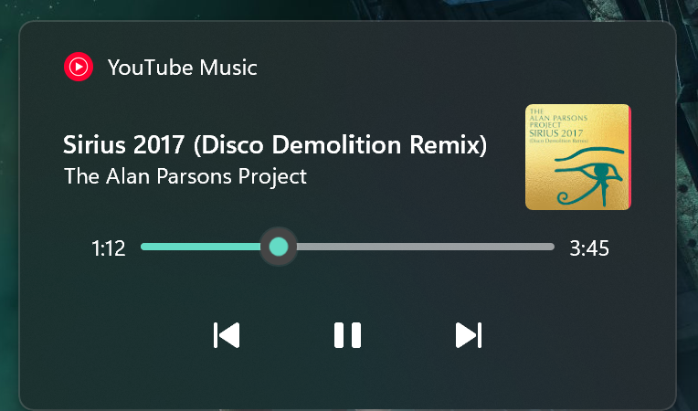

# Simple Media Progress Bar

A Windhawk mod that adds a seek bar with elapsed/total time to the media card in
Windows 11 Quick Settings.

- Windows 11 **24H2 (build 26100) or newer**, x86-64.
- The bar is a real XAML `Slider` inserted into the card, so it uses the platform
  look, the accent color, the standard animations, and the accessibility tree.
- The native previous / play-pause / next buttons are not modified. They keep
  their exact style and position; the bar is placed in its own row above them.
- Apps that do not expose a seekable timeline (live streams, some browsers)
  simply get the normal card without the extra row.

## Install

The mod is not in the Windhawk catalogue yet, so install it from this repository:

1. Open [`simple-media-progress-bar.wh.cpp`](simple-media-progress-bar.wh.cpp)
   and click **Raw** (or download the file).
2. In Windhawk, open **Create new mod**.
3. Replace the whole contents with the downloaded file.
4. **Compile mod**, then **Install**.
5. Close and reopen Quick Settings once. The panel is built on demand, so the bar
   appears the next time the panel opens.

If the panel was already open while the mod was enabled, reopening it is enough;
a `ShellHost.exe` restart is not normally required.

## License

GPL-3.0-only. See [`LICENSE`](LICENSE).
